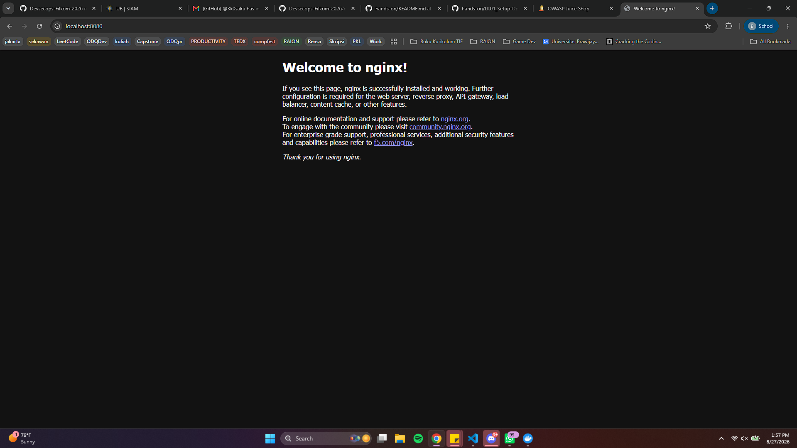
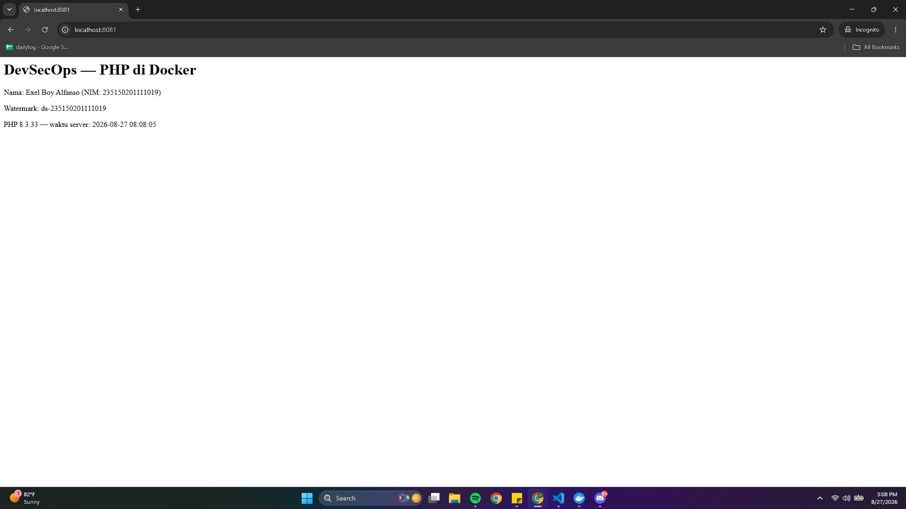

# LK-01 — Setup

> Salin folder ini menjadi `labs/LKxx-...>/` dan isi. Sertakan watermark & refleksi.

- Nama / NIM : Exel Boy Alfanso (235150201111019)
- Watermark : ds-235150201111019
- Minggu : 1

## Langkah yang dilakukan

1. menjalankan commands di bagian b
2. menjalankan nginx dengan command `docker run --rm -d -p 8080:80 --name web nginx`
3. menjalankan `curl.exe -I http://localhost:8080`
4. run `http://localhost:8080` di browser, kemudian simpan bukti
5. membuat folder `php-demo` di `labs\LK01-setup\php-demo`
6. membuat `hello.php` dengan isi

```php
<?php
echo "Halo dari PHP di dalam Docker\n";
echo "Versi PHP: " . PHP_VERSION . "\n";
echo "Watermark: ds-23515020111019\n";
```
7. menjalankan `docker run --rm -v "$($PWD.PATH):/app" -w /app php:8.3-cli php hello.php`
8. mendapat hasil output `hello.php` di terminal dan menyimpan bukti di folder `/labs/LK01-setup/bukti/bukti-nginx.png`
9. membuat `index.php` di `/labs/LK01-setup/php-demo`
10. menjalankan `docker run --rm -d -p 8081:80 -v "$($PWD.PATH):/var/www/html" --name php-web php:8.3-apache`
11. menjalankan `curl.exe -s http://localhost:8081 | Select-Object -First 10`
12. menyimpan bukti di `/labs/LK01-setup/bukti/bukti-nginx.png`
13. konfigurasi git dengan username dan email yang sesuai
14. commit dan push
## Hasil & bukti



## Refleksi (150–300 kata, kata sendiri)

Pada LK01 saya menyiapkan toolchain yang akan digunakan selama praktikum DevSecOps. Saya memulai
dengan memeriksa versi Docker dan Docker Compose, kemudian menjalankan image `hello-world` untuk
memastikan Docker dapat bekerja dengan baik. Setelah itu saya menjalankan container Nginx dan
mengaksesnya melalui port 8080. Saya juga menggunakan curl untuk memeriksa respons dari web server
dan menyimpan tangkapan layar sebagai bukti.

Selanjutnya saya membuat file `hello.php` dan menjalankannya menggunakan image `php:8.3-cli` tanpa
memasang PHP langsung di Windows. Saya kemudian membuat `index.php` dan menjalankannya menggunakan
image `php:8.3-apache`. Dari bagian ini saya memahami bahwa volume digunakan untuk menghubungkan
folder di komputer dengan folder di dalam container, sedangkan port mapping digunakan agar aplikasi
di dalam container dapat diakses dari browser.

Kendala yang saya hadapi adalah penulisan command volume pada PowerShell berbeda dengan contoh untuk
Linux. Saya perlu menggunakan path dari `$PWD` agar folder dapat dipasang dengan benar ke dalam
container. Saya juga harus memastikan port yang digunakan belum dipakai oleh aplikasi lain. Dari LK
ini saya belajar bahwa Docker dapat membuat lingkungan aplikasi menjadi lebih konsisten dan praktis.
Saya juga belajar menjalankan, memeriksa log, mengakses, dan menghentikan container serta menyimpan
hasil pekerjaan ke dalam repositori GitHub.


## Screencast (bila diwajibkan)

- Tautan: <asciinema/loom/drive> — tampilkan watermark/NIM di layar.

---

_Dikerjakan oleh Exel Boy Alfanso (235150201111019) — WM ds-235150201111019_
