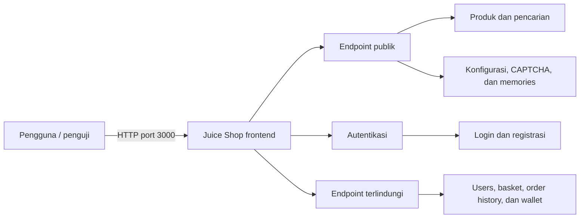

# LK02 — Reconnaissance: Attack Surface

- Nama / NIM: Exel Boy Alfanso (235150201111019)
- Watermark: `ds-235150201111019`
- Target: OWASP Juice Shop (`http://localhost:3000`)
- Tanggal observasi: 3 September 2026
- Kondisi pengujian: tanpa autentikasi

## Diagram attack surface

## Daftar endpoint

| No. | Method | Endpoint | Input utama | Status teramati | Akses tanpa autentikasi | Fungsi / data | Potensi area pengujian |
| ---: | :----: | --- | --- | :---: | --- | --- | --- |
| 1 | `GET` | `/` | — | `200` | Ya | Memuat antarmuka utama aplikasi | Fingerprinting teknologi dan enumerasi aset JavaScript |
| 2 | `GET` | `/api/Products` | Parameter filter/paginasi | `200` | Ya | Mengambil katalog produk | Paparan data dan manipulasi parameter |
| 3 | `GET` | `/rest/products/search?q={query}` | `q` (kata kunci pencarian) | `200` | Ya | Mencari produk | Validasi input/injection (OWASP A03) |
| 4 | `GET` | `/api/SecurityQuestions` | — | `200` | Ya | Mengambil daftar pertanyaan keamanan | Information disclosure dan keamanan proses pemulihan akun |
| 5 | `GET` | `/rest/captcha` | — | `200` | Ya | Menghasilkan CAPTCHA | Otomasi, replay, dan anti-bot control |
| 6 | `GET` | `/rest/user/whoami` | Cookie/header sesi opsional | `200` | Ya | Menampilkan konteks pengguna; respons anonim tetap tersedia | Session handling dan information disclosure |
| 7 | `POST` | `/rest/user/login` | `email`, `password` | `401` untuk kredensial uji tidak valid | Ya | Autentikasi pengguna | Enumeration, brute force, injection, dan session handling (OWASP A07/A03) |
| 8 | `POST` | `/api/Users` | Data registrasi pengguna | Tidak diuji | Ya (route registrasi publik) | Membuat akun baru | Mass assignment dan validasi input; tidak dipanggil agar tidak mengubah data |
| 9 | `GET` | `/rest/admin/application-configuration` | — | `200` | Ya | Mengambil konfigurasi aplikasi untuk frontend | Security misconfiguration/information disclosure (OWASP A05) |
| 10 | `GET` | `/rest/memories` | — | `200` | Ya | Mengambil galeri/memori pengguna | Paparan data dan stored content |
| 11 | `GET` | `/api/Challenges` | — | `200` | Ya | Mengambil metadata challenge | Information disclosure |
| 12 | `GET` | `/api/Users` | Parameter filter/paginasi | `401` | Tidak | Mengambil daftar pengguna | Broken access control dan paparan data (OWASP A01) |
| 13 | `GET` | `/api/BasketItems` | Parameter filter/paginasi | `401` | Tidak | Mengambil item keranjang | Broken access control/IDOR (OWASP A01) |
| 14 | `GET` | `/rest/order-history` | Cookie/header sesi | `500` | Tidak berhasil | Mengambil riwayat pesanan | Penanganan error dan access control perlu ditinjau; server mengembalikan error ketika anonim |
| 15 | `GET` | `/rest/wallet/balance` | Cookie/header sesi | `401` | Tidak | Mengambil saldo wallet | Broken access control dan data sensitif (OWASP A01) |

## Catatan

- Endpoint diperoleh dari observasi aplikasi lokal dan string route pada `main.js`, lalu endpoint `GET` diuji secara pasif dengan `curl` tanpa token atau cookie autentikasi.
- Request login memakai kredensial uji tidak valid dan menghasilkan `401 Unauthorized`.
- Endpoint yang mengubah state tidak dieksekusi selama recon. Karena itu, `POST /api/Users` dicatat berdasarkan route frontend tanpa membuat akun baru.
- Status `200` hanya berarti endpoint dapat diakses pada kondisi pengujian ini; status tersebut bukan bukti bahwa endpoint aman. Kolom terakhir berisi hipotesis untuk pengujian lanjutan, bukan temuan kerentanan yang sudah terkonfirmasi.

---

*Dikerjakan oleh Exel Boy Alfanso (235150201111019) — WM ds-235150201111019*
